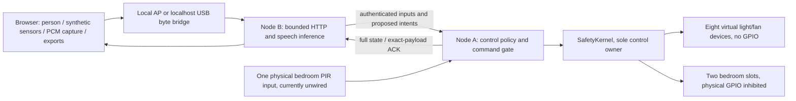

# Current native architecture

20 October 2026. See [simulation lab](SIMULATION_LAB.md) for the detailed execution boundary and [embedded design](EMBEDDED_SYSTEM_DESIGN.md) for scheduling.

Both boards use native ESP-IDF 4.4.7 builds. Speech uses pinned ESP-SR 1.7.0 MultiNet6 English. The Arduino build is historical compatibility source, not the active measured target. The two 8 MiB PSRAM heaps are independent.

A has ControlTask core 1 priority 5, LinkTask core 0 priority 3, and low-priority Diagnostics. B has LinkTask core 0 priority 3, HTTP, Diagnostics and SpeechTask core 1 priority 2. Static queues carry proposals/ACKs; depth-one mailboxes replace stale telemetry/inputs; SDK network queues remain separately allocated. The Wi-Fi receive callback only copies bounded frames.

The browser generates raw synthetic sensor values and formats captured PCM. It performs no recognition, occupancy/control policy or inference fallback. B returns speech proposals only; explicit confirmation traverses the ordinary authenticated command gate. A applies safety constraints even to AI proposals. The offline preview returns HTTP 503 for every API and displays unknown outputs.

Policy and a monotonic boot counter use NVS; transient output/timer/hold state is not restored ON. Authentication, command TTL/order, cached duplicate outcomes and bounded retry protect the software command path. ACKs never claim physical electrical verification.

No AFE/WakeNet/I2S microphone, learned occupancy predictor, tensor splitting, cloud inference, MQTT/database, signed OTA service or physical metering is implemented. B is back on COM7; A remains away. B now exposes a 60-byte shadow evidence monitor and PCM checksum/decoder diagnostics. The monitor has no GPIO authority and is not yet integrated with A. Raw-PCM speech command detection is failing; paired validation still requires A.
