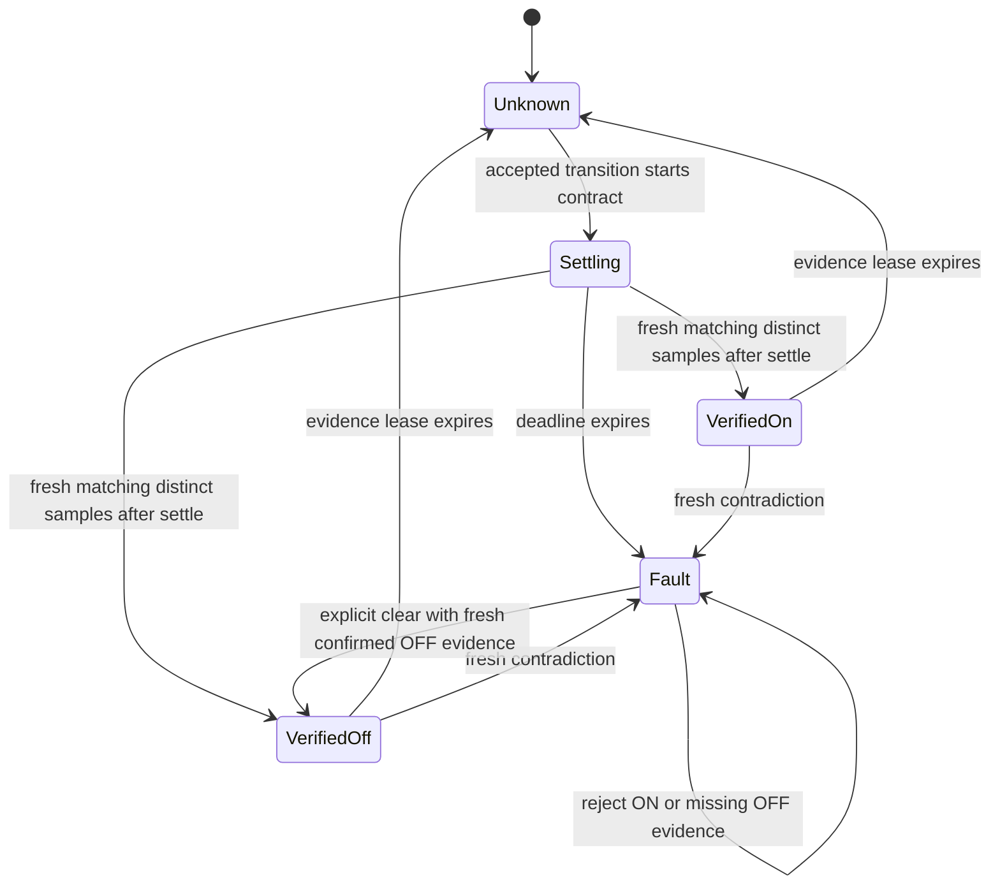

# Actuation evidence monitor specification

The implementation is `firmware/common/runtime/evidence_monitor.h`. It is a fixed-memory **observation component**. It neither executes commands nor replaces SafetyKernel. Current deployment on B exposes shadow tests at authenticated `GET /api/evidence`; it is not wired into A's live device registry or physical feedback drivers.

## Inputs and trust assumptions

A contract configures settling time, evidence lease, verification deadline, required distinct stable samples and two configured measurement-domain identifiers. A new observation carries actuator boot, command ID, sequence, generation time, validity of auxiliary/electrical channels and their ON/OFF interpretations. Generation time must be on the actuator's monotonic clock; timestamps from other clocks need a separately validated mapping.

Only accepted transitions from a future SafetyKernel owner may start a live monitor. Transport identity/authentication and command validation are upstream obligations. The monitor cannot authenticate a value, attest sensor independence, calibrate a current threshold, infer a physically hidden failure or justify the chosen fault domain. Domain IDs are trusted configuration, not proof that sensors cannot share a power/software/calibration failure.

## States

Initial state is UNKNOWN. A software OFF latch at startup is not a physical VerifiedOff state. There is no generic KnownSafe or SafeFallback label. A latched fault can propose OFF through SafetyKernel; it is not physical proof of de-energisation, an emergency stop or a remedy for welded contacts. SafetyKernel may deny a transition during dwell, so actual fallback latency still requires integration and hardware validation.

## Executable requirements

1. Boot/command mismatch, future/pre-command time, stale samples, old sequence and non-increasing sample generation time cannot contribute evidence.
2. Duplicate commands or repeated same-direction pending requests cannot restart the verification deadline. A transition to OFF may supersede a pending ON for recovery.
3. A verified assertion requires both valid modalities, agreement with the desired state, separate nonzero configured domains, elapsed settling and enough distinct stable samples.
4. An expired old lease breaks sample stability; a new observation cannot retroactively erase a blind interval. This deliberately sacrifices availability for continuity.
5. Missing feedback by the deadline latches a timeout. Agreement arriving at or beyond that deadline cannot repair it silently.
6. Fresh contradiction after verification latches disagreement. Missing or expired evidence becomes UNKNOWN; it is not silently retained as verified.
7. Clearing a latched fault is explicit and requires desired OFF plus fresh, distinct, matching OFF observations. An ON command cannot clear a fault.
8. uint32 clock wrap is handled by bounded signed/unsigned deltas. Contracts must stay below half the counter range; boot identity and monotonic-clock assumptions still apply.
9. Every physical request remains owned by SafetyKernel. The monitor provides observations and proposed restrictions only.

Illustrative defaults are 250 ms settling, 500 ms lease, 1000 ms deadline and two stable samples. These are demonstration configuration, not validated constants for a particular relay/fan/current sensor. Physical electrical_on conversion needs a load-specific calibrated threshold and hysteresis; it is not implemented here.

## Verification and memory

23 explicit cases include a 1024-vector value/availability/domain/clock sweep. Host tests compile the actual header. B's shadow API returned all 23 pass bits, 60 bytes per monitor object and 375 us for one complete self-test execution. The grouped self-test timing is not per-action cost, a latency distribution or a WCET bound. A ten-instance registry would require 600 object bytes by this compiler's layout, excluding queues/stack/other state; that array is not currently allocated in live control.

A separate 4096-condition host matrix compares intentionally weakened ablations. It found zero violations of the necessary contract for the full monitor, four conservative refusals and two false physical assertions when both modeled measurements lie. This is finite testing with assumptions, not formal verification of a hybrid electrical plant. See `benchmarks/reports/EVIDENCE_ABLATIONS.csv` and [the research plan](NOVELTY_CASE.md).
