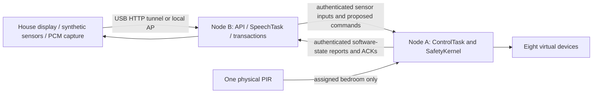

# ClawGrid virtual house and native embedded controller

Status, 20 October 2026: native controller and virtual backend implemented; 81/81 hardware check rows and 83 host tests passed. Model readiness passed; the B-only synthetic audio campaign completed with 0/16 command matches; the live paired workflow remains incomplete. Node B is available on COM7; Node A remains unavailable; use the explicit offline interface preview and read the current validation summary. The older Arduino report is preserved under `benchmarks/reports/native_migration_baseline/`.

## Execution boundary

The laptop/browser draws the house, generates synthetic sensor readings, captures microphone PCM, transports requests and exports measurements. It does not infer occupancy, recognize speech, choose device states or bypass SafetyKernel. Browser-generated position and sensor values are synthetic test inputs, not real multi-room localization.

Node A owns the 5 ms ControlTask, real single-zone PIR tracker, physical-bedroom policy and four virtual-room policies. Eight virtual light/fan devices use GPIO `-1` and pass through the same SafetyKernel as the physical registry. The current build also sets `CLAWGRID_PHYSICAL_OUTPUTS=0`; its two physical-bedroom slots do not drive relay GPIOs. Having two relays available does not establish correct wiring, isolated drivers or feedback.

Node B owns the authenticated API, ESP-NOW transaction manager and an optional independent SpeechTask. The deployed speech build uses ESP-SR 1.7.0 MultiNet6 English, pinned to upstream commit `07b0a4d0f6b5de755874d5405150ee0a8eec9865`. This is a feasible baseline, not a demonstrated best model. It runs on B while A retains control ownership; no memory is pooled between boards and no neural layers are split across their radio link.



## House behavior

- Bedroom, living room, kitchen and study each have a virtual light and fan.
- A controllable person generates independent per-room synthetic PIR and presence inputs. Temperature, illuminance, door state and sensor availability are editable.
- Node A requests lighting when occupied and lux <300, and a fan when occupied and temperature >=28 C. These thresholds are demonstration policies, not learned predictions.
- Virtual occupancy uses positive PIR/presence evidence and a five-second vacancy grace. A door opening alone establishes neither presence nor vacancy. Missing occupancy sensors produce unknown evidence.
- Sensor messages are authenticated, bound to A's boot identity and monotonically ordered, and have a three-second validity window. A stopped stream expires on A. It cannot assert unlimited occupancy.
- All virtual output requests obey three-second dwell, five-minute manual holds and the four-hour maximum run cutoff. Loss of automatic evidence does not cancel an explicit human manual hold; unknown evidence and output state are reported separately.
- The real bedroom PIR uses its separate tracker and configurable 30–1800 second grace. Synthetic evidence never enters that tracker.

## Speech boundary

The browser captures up to four seconds of mono, 16 kHz PCM16LE. Float-to-PCM conversion is input formatting; there is no browser/cloud speech recognizer. The ESP32 reserves one 128,000-byte PSRAM clip buffer and rejects additional jobs while busy. A dedicated 12,288-byte internal stack runs the model; audio is erased from that clip buffer after processing. There is no audio archive on the board.

Sixteen supported phrases cover ON/OFF for the two devices in each virtual room. A detected command becomes a proposal; browser confirmation submits it through B's normal transaction path and A's SafetyKernel. Model scores are not calibrated probabilities. Unknown/no-detection results do not actuate anything.

This configuration uses push-to-talk raw PCM. It does not implement AFE, echo cancellation, WakeNet, continuous listening, arbitrary transcription or a general language model. The browser requests capture without software echo/noise processing. Actual acoustic performance needs independently recorded human speakers, negative utterances, noise and distance tests.

Laptop microphone capture uses `http://127.0.0.1:8765/simulation`, a browser secure context. The USB bridge can keep the laptop's normal Wi-Fi connection intact. A phone can view and control the AP page; microphone capture on plain HTTP is restricted by browsers. No phone settings or software are modified.

## Embedded recovery and memory

Native CMake/ESP-IDF targets coexist with the Arduino baseline. Native defaults select 240 MHz CPU, 80 MHz flash, 80 MHz octal PSRAM, 1 kHz RTOS ticks, static application task stacks and task-watchdog registration. Speech uses 64 KiB data cache and 64-byte cache lines. Medium libc allocations are directed to PSRAM during speech initialization; DMA allocations and RTOS stacks retain their internal-memory capabilities.

Node A stores versioned, CRC-protected policy bytes in NVS. A monotonic boot counter is committed before control is enabled. NVS initialization/counter/config errors disable normal control; NVS is never automatically erased to recover. Rapid edits are coalesced for five seconds and committed in low-priority diagnostics. GPIO state, relative timers, manual holds and pending actions are not restored as ON states. Flash commits can still stall caches and require separate timing observation.

Normal commands have authenticated issuance/TTL fields using A's reported uptime plus report age, bounded to three seconds by B. A validates freshness when executing; exact duplicates return cached outcomes rather than executing again. This tolerates bounded transport skew, not arbitrary clock error. Persistent boot identity is scoped to preserved NVS; factory erasure, restoring old flash/NVS snapshots and key lifecycle remain separate production-security problems.

## Reproduction

```powershell
python -m pip install -r requirements-dev.txt
python scripts/provision_local.py
python scripts/fetch_speech_dependencies.py
python -m platformio run -d native -e native_voice
python -m platformio run -d speech -e speech_intelligence
python scripts/flash_native.py --role A
python scripts/flash_native.py --role B-speech
python -m pytest tests -q --junitxml=benchmarks/raw/host_tests.xml
python scripts/research_hil.py --simulation-only --speech --trials 1000 --soak-seconds 60
python scripts/recovery_hil.py
python scripts/browser_bridge.py --serial COM7
```

Build and flash sequentially. The flasher verifies the assigned MAC and uses installed esptool 5.4; older PlatformIO uploader failures are retained in raw logs. `--app-only` is a development option for an already verified app0/partition/model installation. The GPIO-inhibited HIL mode requires a firmware confirmation before it submits test commands.

Without boards, use `python scripts/browser_bridge.py --preview-only`; all APIs return 503 and outputs remain unknown. To resume the pending hardware campaigns when both boards return, use `python scripts/resume_validation.py --deploy-staged`.

With boards connected, open the localhost URL, enter the ignored local API token, and start the sensor stream. Use arrows/touch dragging, environmental controls, manual virtual-device controls and the room tour. Pause inputs or remove virtual sensors to observe failure handling. Microphone capture begins only after pressing its record button.

Synthetic speech smoke test, with the bridge running and the sensor stream paused:

```powershell
powershell.exe -NoProfile -File scripts/synthesize_speech.ps1
python scripts/audio_bench.py
```

The host C/C++ tests compile the actual firmware policies/wire code with Zig. They are HOST_MEASURED; they are not MCU timing results. Speech clips generated by Windows TTS are SIMULATED inputs. API-reported model execution and radio RTT are HARDWARE_MEASURED. Browser HTTP timing and export calculations are HOST_MEASURED. Never merge these into an unlabeled accuracy/latency figure.

## Publication limits

Passing synthetic-house and synthetic-speech tests does not validate electrical safety, real occupancy accuracy, real microphone acoustics, measured energy savings, backup supply continuity, four physical room controllers, physical three-way feedback, signed OTA or production security. A paper needs a stated contribution, reproducible baselines/ablations, independent evaluation data and limits. Functional completeness of the demonstration alone does not establish novelty.
