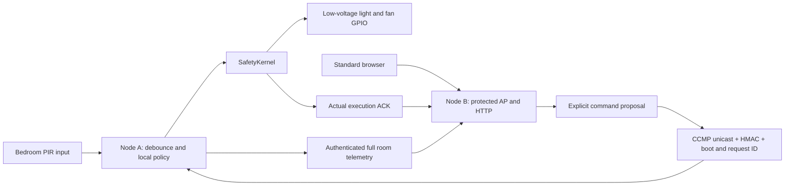

# Implemented architecture

Updated 20 October 2026. Both boards are ESP32-S3 N16R8. The memories remain separate.

Node A's static ControlTask owns device state, automatic policy, relative timers and command execution at a five-millisecond target period. It calls SafetyKernel for output changes. A separate LinkTask authenticates frames and exchanges bounded command/ACK queues and a latest-state snapshot. Low-priority USB diagnostics cannot directly write outputs. A single bedroom PIR cannot localize other rooms; the present bench has no PIR connected.

Node B's HTTP task uses fixed application buffers, at most two client sockets and bounded body lengths. Its explicit static LinkTask processes the RX queue and one pending command with four maximum attempts. Commands are not treated as applied until A acknowledges its result. After five seconds without valid state, new controls are refused and the UI reports unknown outputs. A timeout leaves the command outcome unknown.

The two boards provision pinned peer MACs and unique per-pair PMK/LMK/HMAC credentials. All active application frames carry a mandatory 16-byte authentication tag. State, commands and ACKs use explicit big-endian codecs. The actuator boot nonce and strictly ordered command ID prevent a retry from executing twice. Prototype keys are compiled into firmware; secure boot/flash encryption/HTTPS are not implemented.

Radio processing now continues in LinkTask while the low-priority diagnostics task performs HTTP or memory tests. The essential tasks register with the task watchdog. Timing, jobs, stack margins and missed target deadlines are available over serial; Node B also exposes `/api/rtos`. See [embedded-system design](EMBEDDED_SYSTEM_DESIGN.md) for priorities, cores, ownership, interfaces and submitted-proposal alignment.

No AFE, WakeNet, MultiNet, neural predictor, tensor splitting, WebSocket or cloud fallback is implemented. Those are research extensions with the gates in [publication matrix](PUBLICATION_TEST_MATRIX.md). The existing host simulator is a separate software experiment and does not control the real boards.

See [features and API](HOME_AUTOMATION_FEATURES.md), [memory placement](MEMORY_AND_RUNTIME.md) and [wire protocol](PROTOCOL.md).
